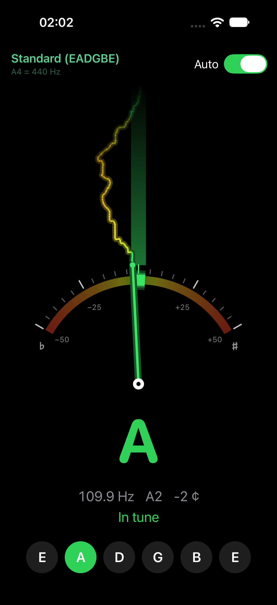

# Tuner

A minimal chromatic guitar tuner for iPhone, written in SwiftUI with no external dependencies.

<p align="center">
  
</p>

## Features

- Needle gauge from −50 to +50 cents, with a colour band (green, yellow, orange, red) and a highlighted ±3-cent green zone.
- Pitch trace: each measurement appears at the needle tip and rises, so you can see whether the note settles or drifts.
- Automatic string detection, or manual string selection.
- Tunings: Standard, Drop D, DADGAD, Open D, Open G.
- Reference pitch A4 = 432, 438, 440 or 442 Hz.
- Haptic feedback when the string is in tune.

## How it works

- Microphone capture with `AVAudioEngine`, audio session in `.measurement` mode (no automatic gain control or voice processing).
- Fundamental frequency detection with the YIN algorithm (de Cheveigné & Kawahara, 2002), vectorised with Accelerate/vDSP: 4096-sample window, about 23 analyses per second, 60 to 1200 Hz.
- Running median over 5 measurements to reject isolated octave jumps.
- No network access and no data collection: audio is analysed in memory and never stored.

## Requirements

Xcode 16.3 or later, iOS 17 or later, iPhone in portrait.

## Build and run

1. Open `GuitarTuner.xcodeproj`.
2. Target GuitarTuner › Signing & Capabilities › Team: select your Apple ID. Change the bundle identifier if it is already taken.
3. Select an iPhone or a simulator and press ⌘R. The simulator uses the Mac microphone.

With a free Apple ID, the app stays installed on a device for 7 days.

## Project layout

```
GuitarTuner/
  TunerApp.swift        entry point
  ContentView.swift     screen: note, frequency, cents, strings, tuning menu
  GaugeView.swift       gauge: colour band, green zone, needle, rising trace
  TunerModel.swift      state, microphone permission, smoothing, string selection
  PitchDetector.swift   audio capture and YIN detector
  Tunings.swift         tunings and note names
```

## Settings in code

- In-tune tolerance and green zone width: `TunerModel.tolerance` (3 cents).
- Trace rise speed: `Dial.riseSpeed` in `GaugeView.swift`.
- Silence threshold: `rmsGate` in `PitchDetector.swift`.
- Detection range: `YIN.minFrequency` and `YIN.maxFrequency`.

## Changelog

- 1.1 (2026-11-06): English interface; redesigned gauge with colour band and green zone; rising pitch trace; smoother needle.
- 1.0 (2026-10-16): first version.

French installation guide: [README.fr.md](README.fr.md).

## License

Licensed under the Apache License, Version 2.0. See [LICENSE](LICENSE).
